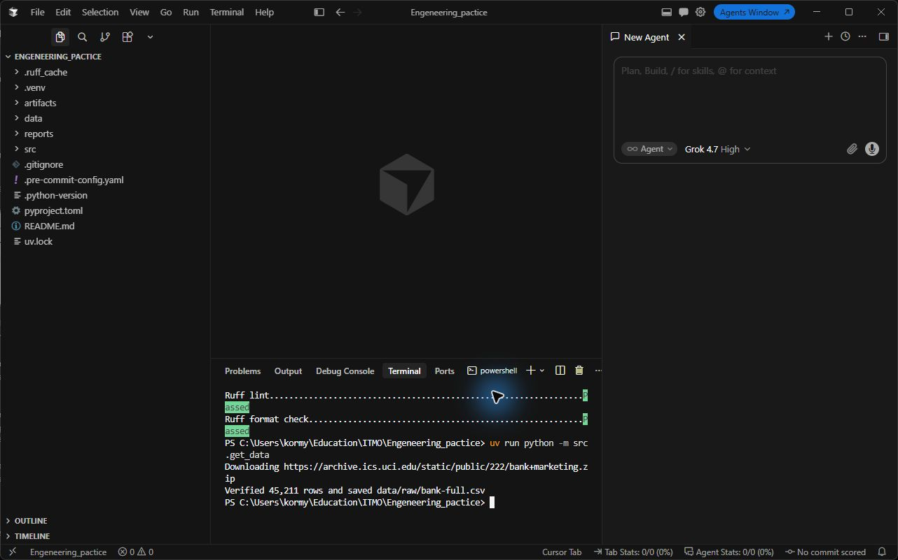
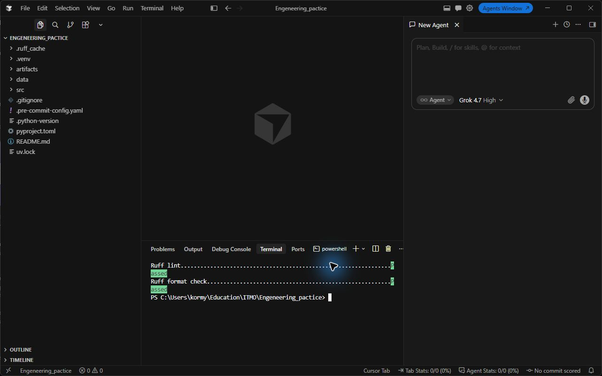
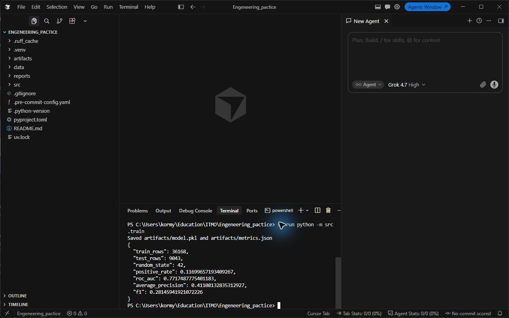

# ДЗ 1. Воспроизводимый ML-проект

Для бинарной классификации взят `bank-full.csv` из UCI Bank Marketing.
Цель — предсказать, оформит ли клиент срочный вклад. Базовая модель —
логистическая регрессия. Длительность звонка исключена из признаков.
Подготовка признаков входит в сохранённый pipeline.

## Загрузка данных

`uv run python -m src.get_data` скачала архив UCI, проверила поля и 45 211
строк, сохранила CSV в `data/raw/bank-full.csv`.

## Проверки кода

`uv run pre-commit run --all-files` прошла проверку линтера и форматирования.
В отдельной проверке на временном файле с неиспользуемым импортом тот же
хук Ruff вернул ошибку F401.

## Обучение

`uv run python -m src.train` создала `artifacts/model.pkl` и
`artifacts/metrics.json`. Для обучения использовано 36 168 строк, для оценки
9 043 строки. Доля положительных примеров в отложенной выборке — 11,70%.

| Метрика | Значение |
| --- | ---: |
| ROC AUC | 0,7717 |
| Average precision | 0,4111 |
| F1 | 0,2815 |

Average precision выше доли положительного класса. F1 при стандартном
пороге показывает, что распознавание положительного класса можно улучшить.
Разбиение случайное и стратифицированное. Результат относится к отложенной
части этой таблицы.

